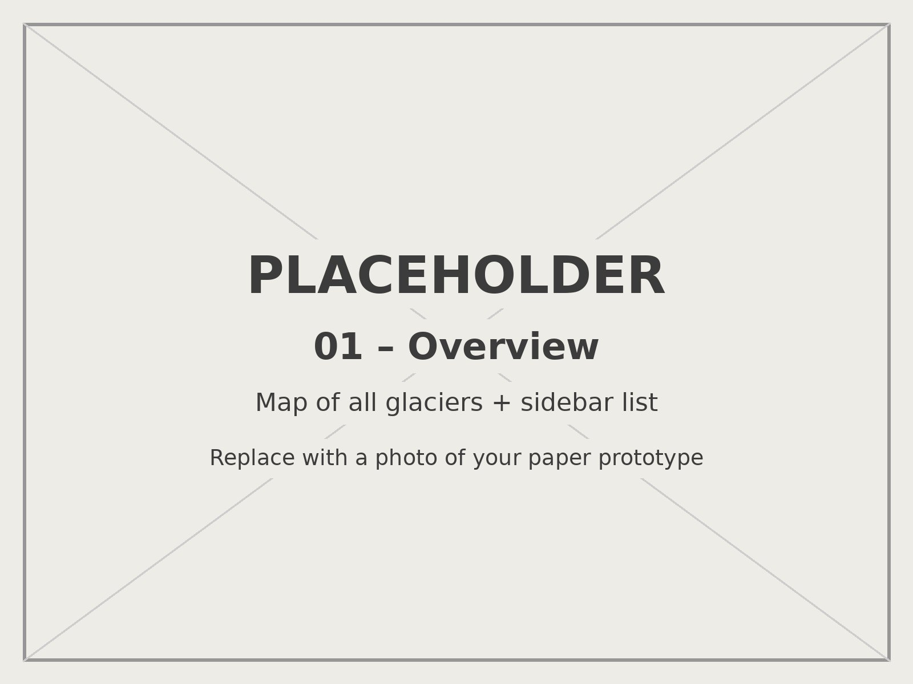

# 01 – Overview

- **Description:** Gletscher hängen als Eiszapfen von oben ins Bild. Unten sammelt sich das Schmelzwasser. Der Zeitstrahl (2000–2100) steuert das Jahr. In der Seitenspalte steht der geschmolzene Anteil als grosse Zahl.
- **Trigger:** Zeitstrahl ziehen, Pfeiltasten (±1 Jahr), Play/Pause (Zeitraffer), Eiszapfen antippen oder anklicken, Maus über einen Eiszapfen (zeigt den Namen).
- **Response:** Zapfen werden kürzer, der Wasserspiegel steigt weich nach, Tropfen fallen schneller oder langsamer. Klick auf einen Zapfen öffnet `02-glacier-selected`.
- **Data:** `massbalance_observation.csv` (`glacier id`, `end date of observation`, `annual mass balance`, `glacier area`) → verbleibendes Eis pro Gletscher und Tropfenrate. Wasserstand = Summe der geschmolzenen Volumen / Summe der Startvolumen 2000.
- **States:** Messjahre 2000–2025 (durchgezogener Zeitstrahl). Projektion 2026–2100 (gestrichelt, Hinweis «Projektion»). Läuft der Zeitraffer, ist der Play-Knopf ein Pause-Symbol.
- **Remarks:** Zapfenbreite ~ Fläche, Zapfenlänge ~ verbleibendes Eis (Startlänge ~ Volumen). Tropfenfrequenz ~ jährliche Massenbilanz. Bei «reduzierte Bewegung» im Betriebssystem fallen keine Tropfen.
