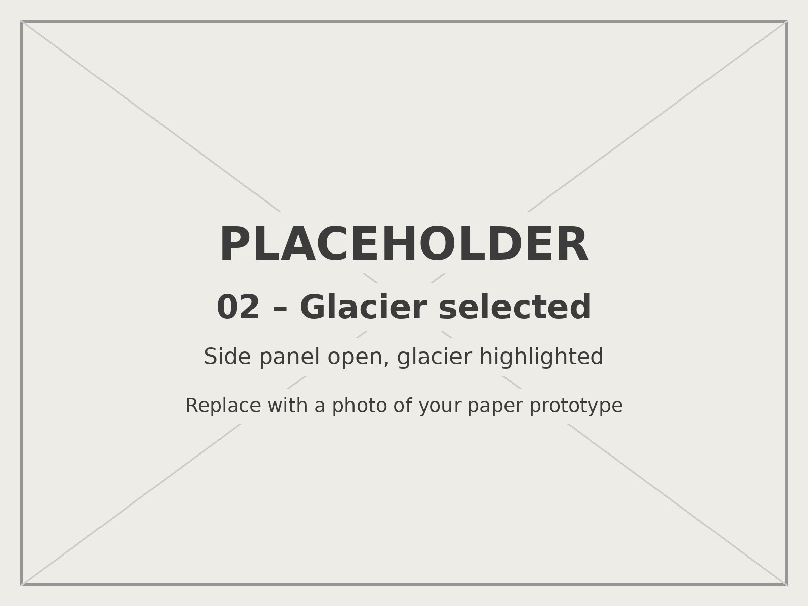

# 02 – Glacier selected

- **Description:** Ein Gletscher ist hervorgehoben (magenta Kontur), alle anderen sind abgeblendet. Die Seitenspalte zeigt Name, verbleibendes Eis in %, einen Verlauf 2000–2100 und Kennzahlen. Der Zeitstrahl bleibt bedienbar, die Werte laufen mit.
- **Trigger:** Eiszapfen anklicken, Taste Enter auf fokussiertem Zapfen. Schliessen mit «Zurück», Esc oder Klick auf den Hintergrund. Ein anderer Zapfen wechselt die Auswahl.
- **Response:** Zurück zu `01-overview`. Zeitstrahl ändert Jahr, Zahlen und Marker im Verlauf.
- **Data:**
  - `massbalance_observation.csv`: `annual mass balance`, `glacier area` (Eis übrig, Fläche, Ø Massenbilanz 2011–2025)
  - `lengthchange.csv`: `glacier id`, `end date of observation`, `length change` (kumulierter Zungenrückzug seit 2000)
  - `volumechange.csv`: `SGI-ID`, `date_start`, `date_end`, `dV`, `dh_mean` (geodätisch gemessener Volumenverlust)
- **States:** Messjahr (≤ 2025) / Projektion (> 2025, Hinweis «Projektion»). Gletscher verschwunden (0 %): Text «Der Gletscher ist … verschwunden». Keine Längenmessung vorhanden: «keine Messung in den Daten».
- **Remarks:** Volumen kommt aus der Volumen-Flächen-Skalierung (nicht aus den CSVs), weil die CSVs keine absoluten Volumen enthalten. Der geodätische Wert dient als Gegenprobe.
